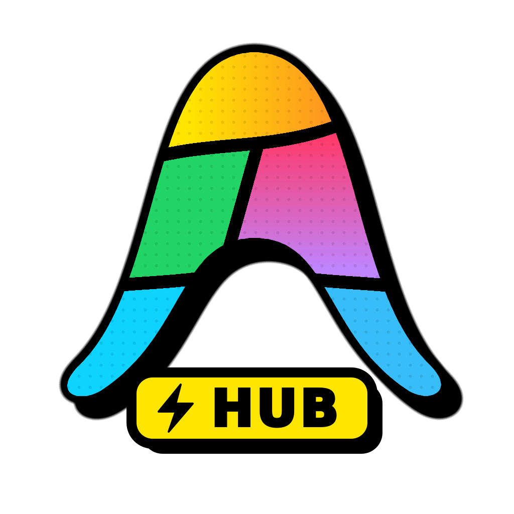
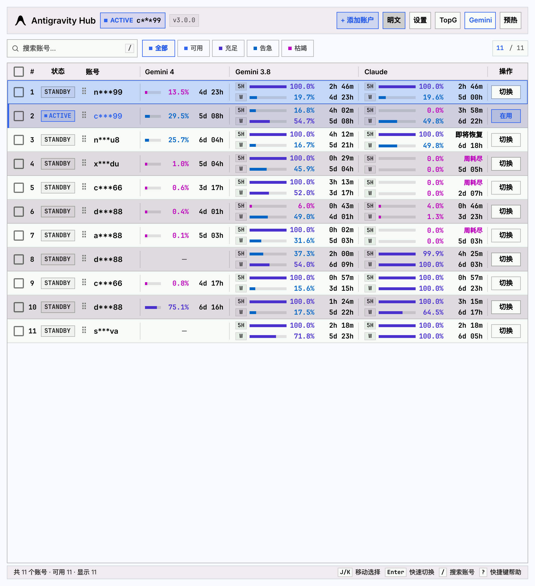
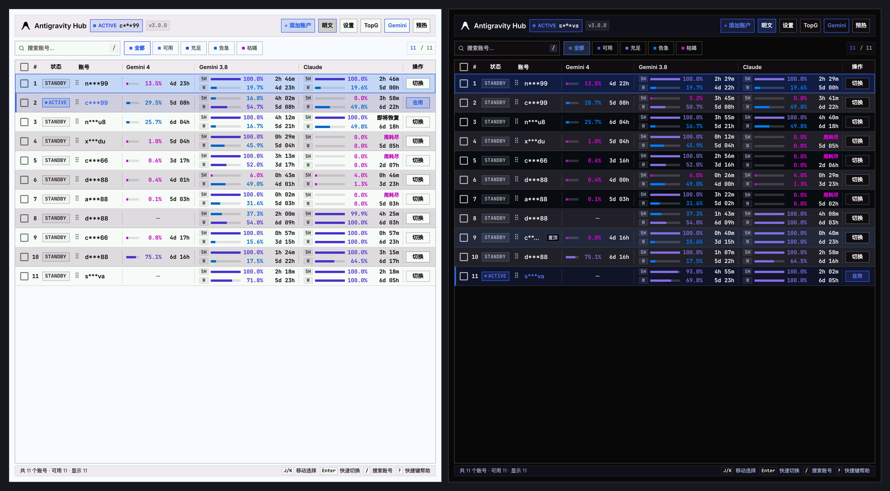

# Antigravity Hub

<p align="center">
  
</p>

<p align="center">
  <strong>专为 Google Antigravity 打造的 Omarchy 原生 C++17 / Qt6 QML 极简高密账号看板、多模型配额看门狗与无感断点接力中枢</strong>
</p>

<p align="center">
  
  
  
  
  
  
  
</p>

<p align="center">
  
</p>

<p align="center">
  <em>图：Antigravity Hub v3.0.4 生产级实际 UI 界面（基于 Omarchy 设计规范，零渐变纯平顶栏、正统 Antigravity 单色剪影 Logo、闭合 1px 细线外框、屏幕绝对固定的偶奇斑马纹行、Gemini 4 / 3.8 / Claude 三模型配额毫米级对齐排版与一键脱敏打码保护）</em>
</p>

---

## ⚡ v3.0.4 核心架构演进与重大革新

**Antigravity Hub v3.0.4** 彻底根治 IDE 与 Hub 配额对齐失准难题，全链路接入原生 `RetrieveUserQuotaSummary` 接口，解决 Google Cloud Code PA 阻断并杜绝虚假配额复制：

1. **直连本地 Language Server 原生 `RetrieveUserQuotaSummary`**：
   - 彻底取代容易受 `gemini-4-carbon-disabled` 干扰的旧版 `GetUserStatus` 逻辑；
   - 100% 对齐 IDE "Models & Usage" 弹窗数据源，独立采集 `Gemini Models`（周/5h）、`Claude and GPT models`（周/5h）与 `Gemini 4 Argon`（独立周配额）；
2. **根除 Gemini 4 伪配额与周倒计时跨槽泄露**：
   - 杜绝当未返回 Argon 独立配额时将 Gemini 3.8 周配额虚假复制赋给 Gemini 4 的不良逻辑；
   - 5 小时重置槽位在配额满额（≥99.9%）时统一标定为 `满额`（Full），彻底消除跨窗口周倒计时误填至 5h 槽位的显示缺陷；
3. **解除 Google Cloud Code PA 接口 403 阻断**：
   - 全网请求统一补全 `{"project": "aicode-consumers"}` 官方载荷与原生 UA，解除后台巡检 403 异常；
4. **Mac 原版单轨嵌入式 Token 保鲜与 `secret-tool` 全端锁定同步**：
   - 彻底修复 Linux 移植版仅在切号时写入凭据、日常使用 1 小时后 Token 自然过期导致“模型失效”的恶性缺陷；
   - 严格对齐 Mac 原版架构：不引入任何冗余的独立看门狗轮询线程，完全将 Token 保鲜嵌入在现有的 `refresh_all_quotas`（配额同步）与 `ensure_fresh_token` 自然调度链路中（并发加锁防重）；
   - 当 Antigravity IDE 自身刷新 `secret-tool` 凭据时，`auto_ingest_system_account` 自动校验时间戳并反向同步锁定 `~/.gemini/oauth_creds.json`、`~/.gemini/jetski-standalone-oauth-token`、`google_accounts.json` 与 `app_storage.json`，消除多存储分裂；
   - 严格执行 **15 分钟临期安全偏置（`TOKEN_REFRESH_SKEW_SECONDS = 900`）**：在 Token 到期前 15 分钟内，后台自动以 `refresh_token` 向 Google OAuth 端点换取全新 3600s `access_token`。
2. **Gemini 4 跨账号串台防污染与 `4.6/disabled` 自动归零**：
   - `sync_from_local_language_server` 识别 `gemini-4-argon-disabled` 与非 `5.5` 模型矩阵时，自动清除跨账号切号残留的伪 `gemini4` 数值并阻断切号瞬态串台；
   - Web UI 与 Qt 原生前端模型层（`AccountModel`）双重校验 `Claude 5.5` 资格，彻底杜绝未开通 Gemini 4 账号（`GOOGLE_ONE_HELIUM` / 4.6）显示虚假进度条。
2. **全端凭据强一致性原子写入契约（Multi-Store Dual Sync）**：
   - 凡活跃账号在嵌入式刷新中发生续签，立即原子级强一致性双向同步：
     1. Linux Secret Service (`secret-tool`) / macOS Keychain (`security`)；
     2. `~/.gemini/oauth_creds.json`（供 `agy` CLI 与工具层直接调用，彻底告别 `invalid_token`）；
     3. `~/.gemini/jetski-standalone-oauth-token`（供语言服务器底层零回退直接解析）；
     4. `~/.gemini/google_accounts.json` 与 `app_storage.json`。
3. **HTTP 401 Unauthorized 反应式自愈机制**：
   - 配额端点探测遇到 401 或空响应时，自动触发 `ensure_fresh_token(force=True)` 一次性强制换取新 Token 并无感重试，杜绝假死与死锁。
4. **正统 Google Antigravity 剪影 Logo 重塑**：
   - 彻底废除旧版几何三角假标与蓝色着色；
   - 基于官方流线型不对称悬浮拱门（Sweeping Aerodynamic Arch）精确矢量化，呈现在高对比度 Omarchy 单色剪影下（浅色极黑 `#0F172A`、深色纯白 `#FFFFFF`），与 `Omarchy Control` 风格完美对齐。
5. **纯正 Omarchy 扁平设计铁律**：
   - **全面清零渐变**：顶栏、状态栏、表头与斑马纹背景实现 `gradient` 语法 0 出现率，消除一切发灰发脏的视觉噪点；
   - **全面直角纯平**：`radius: 0` 严格贯彻，1px 语义线框完整闭合；
   - **屏幕绝对固定斑马纹**：彻底分离数据排序与视觉行号，奇偶行背景在任意动态拖拽或表头排序时永远保持绝对交替，杜绝双灰行重叠；
   - **固体防穿透浮动通知（Solid Toast）**：通知条采用实色表面背景搭配左侧 3px 语义状态条，彻底杜绝底层表格文字穿透干扰。
3. **Mac 级半行检测拖拽排序与一键置顶**：
   - 自由上下拖拽账号手柄（`⠿`），支持从最底部一键拖拽至最顶端或任意中间行；
   - 上半行向上插入、下半行向下插入精准检测，配合 3px 蓝绿色插入指示线；
   - 重排结果即时生效并原子级落盘持久化至 `accounts_order`。
4. **全键盘无鼠标工作流与模态防穿透**：
   - `j`/`k` 或方向键平滑导航、`Enter` 毫秒级原生热切号；
   - `isModalOpen` 模态守卫全面覆盖「添加账户」、「系统设置」、「批量删除确认」及「帮助速查」，弹窗开启时底层快捷键物理阻断，`Esc` 分级平滑回退。
5. **严苛的六层全栈测试矩阵**：
   - 28 项 QtTest 单元测试 + 9 项 E2E 真实键鼠拖拽测试，覆盖静态规范、主题 WCAG 对比度、数据模型角色非遮蔽、多尺寸平铺及实机 Wayland 像素级核验，100% 绿灯交付。

---

## 🖥️ 响应式平铺与多主题适配

Antigravity Hub 专为 Hyprland 动态平铺窗口管理器打造，支持自适应栅格布局：

| 布局模式 | 几何尺寸 | 响应式特性 |
| :--- | :--- | :--- |
| **半屏平铺 (Tiled)** | `941 × 1030` | 8 大列紧凑排布，配额进度条与数字倒计时垂直严密对齐 |
| **全屏展示 (Fullscreen)** | `1896 × 1030` | 账号名称与配额槽自适应拉伸，高密视觉依然干爽整洁 |
| **最小受控窗口** | `920 × 540` | 水平滚动条按需启动，表头与数据列绝对锁定无缝对齐 |

<p align="center">
  
</p>

<p align="center">
  <em>图：浅色主题（Omarchy Lupine）与强制深色主题双态同屏实机对比（支持半屏平铺自适应、零渐变高对比单色剪影 Logo 与 WCAG ≥ 4.5:1 选区自适应）</em>
</p>

---

## ⌨️ 全局快捷键速查表

在应用任意位置均可使用键盘高效驱动：

| 快捷键 | 功能描述 | 交互行为 |
| :--- | :--- | :--- |
| `j` / `↓` | 下移选择 | 选择列表中的下一个账号 |
| `k` / `↑` | 上移选择 | 选择列表中的上一个账号 |
| `PgUp` / `PgDn` | 快速翻页 | 每次按 15 个账号步长快速翻页 |
| `Enter` | 原生热切号 | 毫秒级原子重载，IDE 编辑器与终端零中断 |
| `/` | 聚焦搜索 | 光标聚焦至搜索栏，支持实时模糊筛选 |
| `m` | 隐私脱敏打码 | 一键在明文与 `c***8` 脱敏打码模式间切换（截图保护） |
| `r` | 并发刷新 | 后台异步探针拉取最新配额数据 |
| `s` | 偏好设置 | 呼出控制台配置对话框 |
| `g` | 切换至 TopG | 自动计算并一键切入当前 Gemini 配额最高的健康账号 |
| `w` | 全池错峰预热 | 触发全池长连接预热与滑动窗口建立 |
| `?` / `F1` | 帮助弹窗 | 切换全局快捷键速查中心 |
| `Esc` | 分级取消 | 优先关闭弹窗 → 清空搜索输入并释放焦点 |
| `q` | 退出程序 | 安全清理并退出 Antigravity Hub |

---

## 🛠️ 构建、测试与运行

### 1. 系统依赖
确保 Omarchy / Arch Linux 系统已就绪标准 C++ 与 Qt6 基础包：
```bash
omarchy-pkg-add base-devel qt6-base qt6-declarative qt6-svg hicolor-icon-theme
```

### 2. 编译与测试
```bash
# 进入项目工作区
cd ~/Projects/antigravity-hub

# 快速编译并构建二进制产物 (产物位于 build/antigravity-hub)
./bin/build

# 离线执行全套 28 项 Qt Test 自动化测试套件
./bin/test
```

### 3. 安装与运行
```bash
# 复制二进制至用户执行路径
cp build/antigravity-hub ~/.local/bin/antigravity-hub

# 启动原生桌面应用
antigravity-hub
```

---

## 📄 开源许可证

本项目采用 [MIT License](LICENSE) 授权许可。
