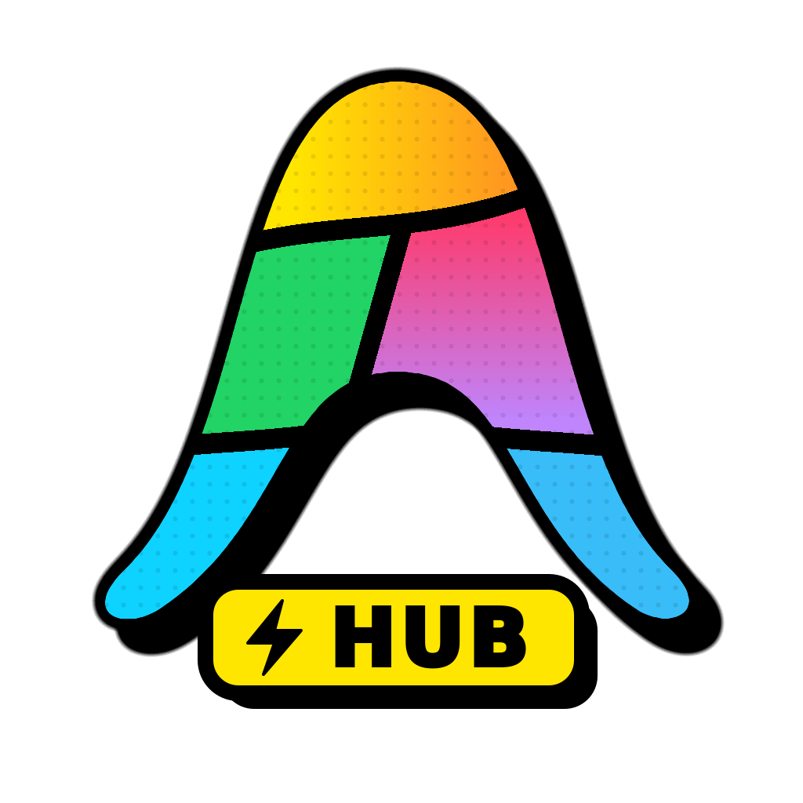
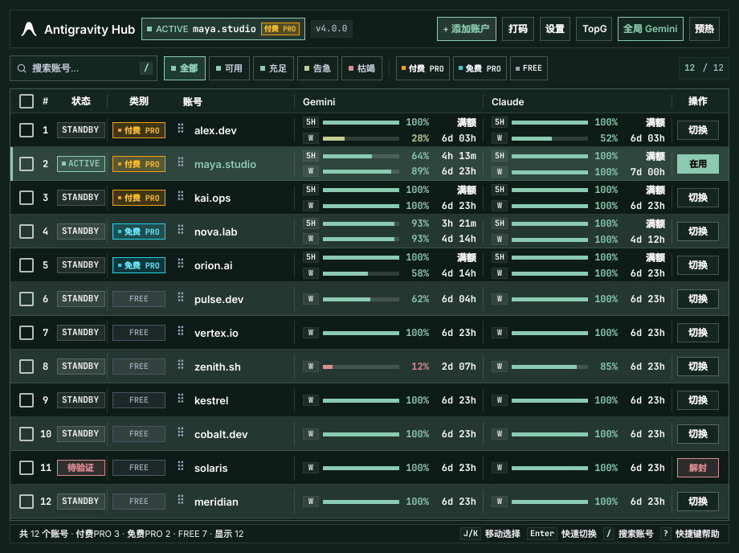
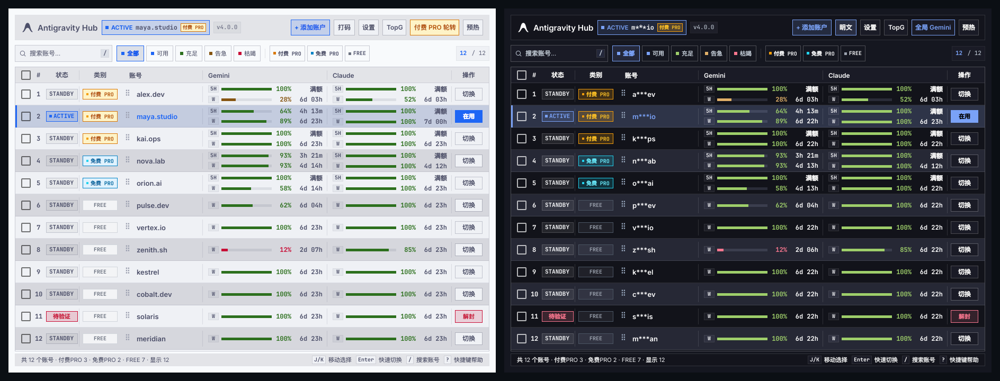

# Antigravity Hub

<p align="center">
  
</p>

<p align="center">
  <strong>Google Antigravity 多账号无感轮转中枢（Linux / macOS 双平台）：零反代原生钥匙串热切、全自动三档分级、全局 Gemini 与付费 PRO 专享看门狗</strong>
</p>

<p align="center">
  
  
  
  
  
  
</p>

<p align="center">
  
</p>

<p align="center">
  <em>图：Antigravity Hub 原生桌面客户端实拍（全合成演示账号）：独立「类别」列一键区分付费 PRO / 免费 PRO / FREE，对齐官方 Gemini 与 Claude 双配额列，FREE 账号单轨周限清爽呈现，固定 15 行高度锁死、支持顶栏自由拖动与左右拉伸</em>
</p>

---

## 🔥 v4.3.2 重要更新（固定 15 行高度锁死 + 仅允许左右拉伸 + 顶栏原生窗口拖动）

- **固定 15 行上下高度锁死与仅允许左右拉伸（v4.3.2）**：彻底移除动态高度变化逻辑，窗口上下高度永恒锁定为 15 个账号的标准高度（`814px`，`minimumHeight === maximumHeight === 814`），彻底禁止上下自由缩放；账号少于 15 个时列表下方自然留白，超过 15 个时右侧自动显现 Omarchy 同风格直角滚动条（拉条），默认宽度 `720px` 且仅允许用户自由拉伸左右宽度；
- **顶栏原生窗口自由拖动（v4.3.2）**：在顶栏底层接入 Wayland / X11 原生 `startSystemMove()` 拖拽支持，按住顶栏任意空白区域或标题文字即可直接自由拖动窗口，彻底解决无外部标题栏时窗口无法移动的问题，同时零拦截顶栏按钮点击；
- **毫秒级关联地区受限检测与自动复权（v4.3.0）**：刷新配额时并发调用 Google 官方 `v1internal:loadCodeAssist` 探测账号底层关联地区资格；若命中 `UNSUPPORTED_LOCATION`（如关联地区为中国、无法使用 Antigravity 的账号），立即在账号名后标注高对比矢量红旗 🇨🇳，右侧操作按钮切换为红色「**解锁**」（点击直达带账号预选的 Google 官方地区修改申请页 `policies.google.com/country-association-form`），且自动轮转看门狗与后台预热引擎同步隔离受限账号；地区修改审核通过后下次刷新自动移除红旗并恢复切换；
- **720px 默认最小紧凑宽度与双配额条压缩（v4.2.0）**：删除与「操作」列功能重叠的「状态」列（保留复选框与数字序号 `#`），压缩 Gemini 与 Claude 进度条长度及列宽（单列从 `234px` 降至 `182px`），整体内容宽度从 `896px` 压缩至 `696px`，默认启动宽度锁定最小宽度 **`720px`**（直降 `200px`），同时删除 `TopG` 与手动「预热」按钮并将预热开关收口至「设置」；
- **周额度不足 0.5% 即时短路「用尽」（v4.1.1）**：针对账号周额度仅余极微小数（如 `0.45%` 在界面四舍五入显示 `W: 0%`）而官方 API 仍返回 `5H: 100%` 并附带 5H 倒计时的矛盾场景，Linux Qt6 桌面端与 macOS Web 端统一步调：凡 `W < 0.5%` 的桶，其 `5H` 行强制短路归零并显示 `用尽`（英文界面 `Depleted`），不再误导展示 `100%` 或 5H 倒计时；预热引擎同步跳过 `< 0.5%` 枯竭周桶（保留同号可用双桶如 Claude 正常预热），轮转器内部仍保留 `EXHAUSTED_EPS = 0.0001` 精确榨干逻辑；
- **真实 1-token 随机错峰预热与 Mac Web 端同步（v4.1.0）**：后台随机打散顺序向未激活的健康 PRO 账号发起真实极简调用（2 至 11 Tokens）锁死 Google 官方 5H 倒计时时钟，5H 满额时直接透传并实时渲染真实倒计时（如 `4h 58m`），macOS Neo-Brutalism Web 端全功能同步。

---

## 🚀 v4.0.0 架构核心特性

**Antigravity Hub v4.x** 是面向真实多账号生产工作流的重构系列，从底层配额采集、账号分级判定、自动轮转策略到桌面端窗口几何全部对齐 Google 官方接口事实：

### 1. 全自动三档账号体系（零手工配置，显著视觉区分）
后台自动融合 Google 官方 `retrieveUserQuotaSummary` 配额桶结构与 `fetchAvailableModels` 可用模型矩阵，将账号池精准划分为三档，无需手写白名单，新增账号自动归类：

| 账号类别 | 徽标样式 | 判定依据（官方 API 事实） | 配额轨道形态 | 模型能力 |
| :--- | :--- | :--- | :--- | :--- |
| **付费 PRO** (`PAID_PRO`) | 琥珀金边框与金点高亮 | 返回 `5H + 周` 双桶，且开通 Claude 5.5 / Gemini 4 模型矩阵 | `5H` + `W` 双轨 | 满血 Gemini 4 + Claude 5.5 |
| **免费 PRO** (`FREE_PRO`) | 青蓝色边框与蓝点标识 | 返回 `5H + 周` 双桶，模型矩阵为 Claude 4.6 / Gemini 3.8 | `5H` + `W` 双轨 | Gemini 3.8 + Claude 4.6 |
| **FREE** (`FREE`) | 中性灰低饱和描边 | 仅返回 `周` 单桶（无 `5H` 滑动窗口） | **`W` 单轨垂直居中** | 仅周限基础配额 |

- **独立高辨识度「类别」列**：置于「序号 `#`」与「账号」之间，支持点击表头按 `付费 PRO → 免费 PRO → FREE` 一键排序；
- **顶部栏实时同步**：左上角 `ACTIVE <账号>` 徽章右侧同步嵌入当前在用账号的类别微标，随时掌握当前会话运行在哪一档账号；
- **筛选栏三档快筛**：支持按 `付费 PRO`、`免费 PRO`、`FREE` 一键过滤并与状态标签（全部 / 可用 / 充足 / 告急 / 枯竭）组合筛选，底部状态栏实时汇总各档账号数量。

### 2. 对齐官方配额视图，彻底根绝虚假额度展示
- **删繁就简，回归官方两列**：彻底移除历史遗留的 `Gemini 4` 与 `Gemini 3.8` 割裂列，严格按官方 `RetrieveUserQuotaSummary` 分组只展示 **`Gemini`** 与 **`Claude`** 两列配额；
- **FREE 单轨居中呈现**：对没有 5 小时滑动窗口的免费账号彻底隐藏无意义的 `5H` 轨道，仅垂直居中展示 `W` 周配额，一眼区分 Pro 双轨与 Free 单轨；
- **杜绝数据污染与误判**：无 `5H` 桶时底层物理落盘 `null`（绝不默认回填 `100%` 满额），周额度归零时 `5H` 自动短路熔断显示 `周耗尽`，同时修复健康 FREE 账号被误判进入「告急」筛选的问题。

### 3. 新一代三态智能自动轮转（全局 Gemini / 仅付费 PRO / 已关闭）
彻底移除无实际意义的 Claude 轮转模式，顶栏轮转胶囊支持三态循环切换：

1. **`全局 Gemini`（默认）**：全池所有健康账号（含付费 PRO、免费 PRO 及仅周限的 FREE 账号）统一参与 Gemini 额度监控与瀑布接力；
2. **`付费 PRO 轮转`（琥珀金高亮）**：看门狗自动轮转**严格锁定在 `PAID_PRO` 付费账号池内**，耗尽后只切往下一个付费 PRO 账号，绝不降级到仅限 Gemini 3.8 的账号；
3. **`已关闭`**：冻结后台看门狗自动切号，保留全部手动切换与监控能力。

- **0% 用尽再切换 + 两级健康隔离池**：默认告急阈值下限为 `0%`（严格等到 `<= 0.01%` 真正耗尽才接力），同时将 `>= 2%` 健康主力池与 `1%` 低周额度残丝池物理隔离，杜绝 `5H=100%, 周=1%` 的残丝账号抢占自动选号。

### 4. 默认最小紧凑宽度与高度自适应窗口
- **开箱即最小宽度**：启动默认宽度锁定为超紧凑最小宽度 `720px`（内容区 `696px` + 边距 `24px`），零冗余横向留白，且不限制最大宽度，随时支持用户手动拖拽拉伸；
- **高度按账号数动态贴合**：启动时根据账号池数量精准计算理想窗口高度（单行 `42px`，自动适配 4 至 15 行并受屏幕可用高度安全约束），做到多账号一屏尽览、零多余底部黑边；一旦用户手动拉伸窗口，立即尊重用户尺寸绝不回弹抢夺。

### 5. 全端凭据强一致同步与精准会话接力
- **原生双源采集**：优先直连本地 Antigravity Language Server 的 `RetrieveUserQuotaSummary` 接口，兼顾远端官方端点并发刷新与 HTTP 401 自动续签自愈；
- **嵌入式 15 分钟临期保鲜**：Token 到期前 15 分钟自动静默换新，并原子同步至 Linux Secret Service (`secret-tool`) / macOS Keychain、`~/.gemini/oauth_creds.json`、`~/.gemini/jetski-standalone-oauth-token`、`~/.gemini/google_accounts.json` 等全部凭据存储；
- **精准在途会话恢复**：切换账号前通过 `GetAllCascadeTrajectories` 仅快照真实运行中的根会话，绝不误唤醒已完结历史标签页。

---

## 🎨 多主题自适应与一键隐私打码

Antigravity Hub 深度遵循 Omarchy 纯平直角高对比设计规范（`radius: 0`、零渐变、WCAG `>= 4.5:1` 文本对比度），实时跟随系统主题配置（`~/.config/omarchy/current/theme/colors.toml`），并支持亮色、暗色与跟随系统三态切换，同时内置 **`m` 键一键隐私打码**（`alex.dev` → `a***ev`）保护截图与录屏安全。

<p align="center">
  
</p>

<p align="center">
  <em>图：左为浅色主题下的「付费 PRO 轮转」琥珀金高亮状态；右为深色主题（Tokyo Night）开启一键隐私打码（`m`）后的脱敏展示效果（全部使用合成演示数据）</em>
</p>

---

## 🏗️ 系统架构概览

```text
antigravity-hub/
├── src/                      # C++17 + Qt 6 Quick / QML 原生桌面客户端
│   ├── main.cpp              # 入口、版本声明与 QML 上下文装配
│   ├── models.h / models.cpp # AccountModel 三档自动分级、倒计时与代理过滤排序
│   ├── backend.h / .cpp      # 异步 HTTP 通信、轮转控制与系统通知桥接
│   ├── theme.h / theme.cpp   # Omarchy colors.toml 动态解析与 WCAG 对比度引擎
│   ├── HeaderBar.qml         # 顶部活跃账号 + 等级微标 + 三态轮转胶囊
│   ├── FilterBar.qml         # 实时搜索 + 状态过滤 + 三档类别快筛
│   ├── AccountListView.qml   # 7 列超紧凑矩阵、拖拽排序、Pro 双轨 / FREE 单轨渲染
│   └── i18n/                 # 中英文实时无重启热切换词库 (zh-CN / en)
├── hub/
│   └── server.py             # 本地常驻 HTTP 守护中枢 (127.0.0.1:18088) 与同步 Web 看板
├── core/
│   ├── rotator.py            # 配额看门狗与两级健康隔离瀑布轮转引擎
│   ├── switcher.py           # 多存储原子热切号与钥匙串同步引擎
│   └── recovery.py           # Language Server 在途会话精准快照与异步接力
├── tests/
│   ├── antigravity-hub_tests.cpp    # 31 项 QtTest 离屏单元测试（模型、主题、几何与倒计时防遮蔽）
│   ├── test_rotator_precision.py    # Python 看门狗选号与付费 PRO 隔离精度测试
│   └── test_warmup_and_mac_sync.py  # 真实 1-token 错峰预热与 macOS Web 端同步回归测试
└── bin/
    ├── build                 # qmake6 单二进制编译脚本
    ├── test                  # 离屏自动化测试执行器
    └── install               # Arch PKGBUILD 或用户空间 (~/.local) 一键安装脚本
```

---

## ⌨️ 全局快捷键速查表

在应用任意位置均可纯键盘驱动，弹窗打开时自动启用模态守卫防止误触：

| 快捷键 | 功能 | 说明 |
| :--- | :--- | :--- |
| `j` / `↓` | 下一账号 | 向下移动当前焦点行 |
| `k` / `↑` | 上一账号 | 向上移动当前焦点行 |
| `PgUp` / `PgDn` | 快速翻页 | 按每页 20 个账号步长翻页 |
| `Enter` | 热切账号 | 毫秒级原子切换至选中账号，不中断在途会话 |
| `/` | 聚焦搜索 | 聚焦搜索栏，支持按账号名及 `paid`、`pro`、`free`、`5.5` 等关键词筛选 |
| `m` | 隐私打码 | 一键在明文与脱敏打码（`a***ev`）间切换，截图分享零泄露 |
| `r` | 刷新配额 | 后台并发向官方接口拉取全池最新配额 |
| `s` | 偏好设置 | 打开控制台设置弹窗（阈值、策略、自动随机预热开关、主题、语言） |
| `?` / `F1` | 快捷键帮助 | 打开或关闭全局快捷键速查浮层 |
| `Esc` | 分级取消 | 依次关闭弹窗、清空搜索或释放输入焦点 |
| `q` | 退出应用 | 安全退出桌面客户端（后台守护服务持续运行） |

---

## 🛠️ 快速开始（Linux / macOS 双平台）

### macOS（零依赖，30 秒开箱即用）

无需安装任何第三方 Python 包，原生对接 macOS Keychain (`security`) 与官方 Antigravity 客户端：

```bash
git clone https://github.com/dunova/antigravity-hub.git
cd antigravity-hub

# 一键启动配额看门狗 + 本地管理看板并自动打开浏览器 (http://127.0.0.1:18088)
python3 start_hub.py --port 18088 --open-browser

# 可选：首次运行一键从 macOS Keychain 吸纳当前已登录的 Antigravity 账号
python3 start_hub.py --sync-active
```

### Linux（Arch / Omarchy 原生 C++17 + Qt6 桌面端 + 本地守护中枢）

#### 1. 安装编译依赖

```bash
sudo pacman -S --needed base-devel qt6-base qt6-declarative qt6-svg hicolor-icon-theme python
```

#### 2. 编译与运行全部自动化测试

```bash
git clone https://github.com/dunova/antigravity-hub.git
cd antigravity-hub

# 编译原生二进制（产物位于 build/antigravity-hub）
./bin/build

# 运行 32 项 Qt6 离屏单元测试 + 28 项 Python 自动化回归测试
./bin/test
python3 -m unittest discover -s tests -p "test_*.py" -v
```

#### 3. 本地安装与启动

```bash
# 安装至用户目录 (~/.local/bin/antigravity-hub 与桌面入口，无需 sudo)
./bin/install --local

# 或通过 Arch PKGBUILD 系统级安装
./bin/install --pkg

# 启动后台配额守护中枢（默认监听 127.0.0.1:18088）
python3 start_hub.py --port 18088
# 若已配置 systemd 用户服务：
systemctl --user enable --now antigravity-hub.service

# 启动原生桌面客户端
antigravity-hub
```

---

## 🔒 隐私与安全声明

- 所有账号凭据与配额缓存仅存储在本地用户目录（`~/.antigravity_hub/`），绝不向任何第三方服务器上传；
- 仓库内全部文档截图与测试样例均使用 **100% 合成虚拟账号** 生成，不含任何真实邮箱或 Token。

## 📄 开源许可证

本项目基于 [MIT License](LICENSE) 开源。
